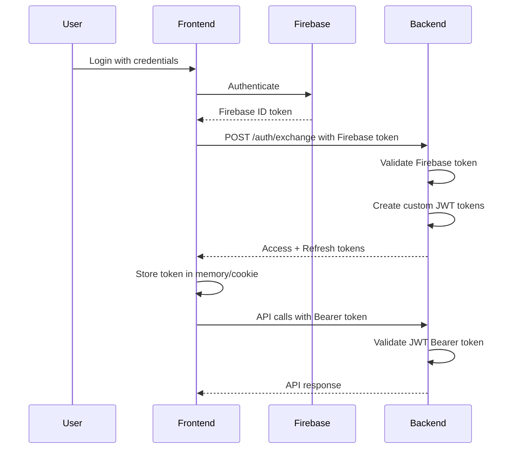
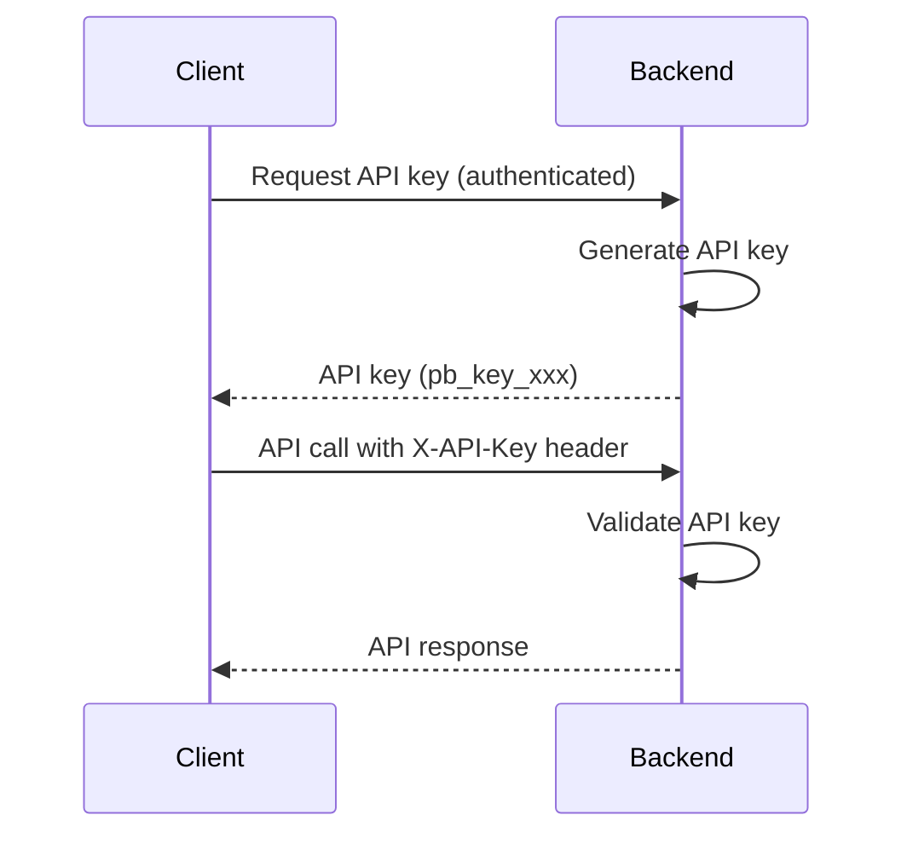

# ProtoBox Authentication Architecture

## Overview

ProtoBox uses a dual authentication system that supports both web frontend users (via JWT Bearer tokens) and third-party API clients (via API keys). The system is built on Firebase Authentication for user management with custom JWT tokens for session management.

## Authentication Flow

### 1. Frontend Authentication (Web Users)



**Key Points:**
- Users authenticate with Firebase (Google, Email/Password, etc.)
- Firebase tokens are exchanged for custom JWT tokens
- Frontend sends JWT as `Authorization: Bearer <token>` header
- Tokens are validated on each API request
- Access tokens expire in 1 hour, refresh tokens in 30 days

### 2. API Key Authentication (Third-Party Clients)



**Key Points:**
- API keys for programmatic access
- Format: `pb_key_{workspace_id}_{random_token}`
- Sent via `X-API-Key` header
- No expiration (revocable)
- Workspace-scoped access

## Implementation Details

### Backend Components

#### 1. Firebase Authentication (`firebase_auth.py`)
- Validates Firebase ID tokens
- Extracts user information
- Development-only test tokens (when `ENVIRONMENT=development`)

#### 2. JWT Authentication (`jwt_auth.py`)
- Creates and validates custom JWT tokens
- Access tokens (1 hour expiry)
- Refresh tokens (30 days expiry)
- Contains user ID, email, workspace, permissions

#### 3. Workspace Auth Middleware (`workspace_auth.py`)
Authentication priority:
1. **JWT Bearer Token**: Check `Authorization: Bearer` header for JWT
2. **JWT Cookie**: Check cookies for JWT (fallback)
3. **API Key**: Check `X-API-Key` header or specific format

```python
# Authentication flow in middleware
async def _handle_unified_auth():
    # 1. Try JWT Bearer token
    if bearer_token and is_jwt_format(token):
        return validate_jwt_bearer(token)
    
    # 2. Try JWT from cookies
    if cookie_token:
        return validate_jwt_cookie(cookie_token)
    
    # 3. Try API key
    if api_key and (starts_with("pb_key_") or in_header("X-API-Key")):
        return validate_api_key(api_key)
    
    # No valid auth
    raise HTTPException(401)
```

### Frontend Components

#### API Client (`client/lib/api/client.ts`)
- Extracts token from cookies
- Adds `Authorization: Bearer <token>` to all requests
- Automatic token synchronization

```typescript
// Frontend sends JWT as Bearer token
setAuthToken(token: string) {
    this.defaultHeaders['Authorization'] = `Bearer ${token}`;
}
```

### Token Structure

#### JWT Access Token Claims
```json
{
  "uid": "user_123",
  "email": "user@example.com",
  "workspace_id": "ws_abc123",
  "role": "admin",
  "permissions": ["read", "write"],
  "token_type": "access",
  "provider": "firebase",
  "iat": 1234567890,
  "exp": 1234571490
}
```

#### API Key Format
```
pb_key_{workspace_id}_{random_token}
Example: pb_key_ws_abc123_a1b2c3d4e5f6g7h8
```

## Local Development with Firebase Emulator

For local development and testing, ProtoBox uses Firebase Auth Emulator to simulate Firebase authentication without hitting production services. This provides:

- **Fast local testing** - No network latency
- **Isolated test environment** - No production data contamination
- **Automated testing** - Integration tests can create and authenticate test users
- **Cost savings** - No Firebase usage charges during development

### Setup

The Firebase emulator is automatically started when you run:
```bash
make start  # Starts backend, frontend, MongoDB, and Firebase emulator
```

Or start it manually:
```bash
make emulator-start  # Start Firebase emulator
make emulator-status # Check if emulator is running
make emulator-stop   # Stop Firebase emulator
```

### How It Works

1. **Automatic Detection**: When `FIREBASE_AUTH_EMULATOR_HOST` is set (set in `.env` by the default setup), the backend automatically uses the emulator
2. **Same Authentication Flow**: The authentication flow remains exactly the same as production
3. **Test Users**: Create test users programmatically or via the emulator UI at http://localhost:4000

### Creating Test Users

```bash
# Create test users programmatically
make emulator-setup-users

# Or use the emulator UI
open http://localhost:4000/auth
```

### Configuration

The default `.env.example` sets:
- `FIREBASE_AUTH_EMULATOR_HOST=localhost:9099`
- `FIREBASE_PROJECT_ID=demo-protobox` (same as production)
- `ENVIRONMENT=dev_test`

This ensures the authentication system behaves identically to production, just using the local emulator.

## Environment Configuration

### Required Environment Variables

```bash
# All Environments
MCP_SECRET_KEY=<jwt_signing_secret>
MCP_MONGODB_URL=<mongodb_connection_string>
MCP_ADMIN_ENABLED=true

# Firebase Configuration
FIREBASE_PROJECT_ID=<project_id>
FIREBASE_SERVICE_ACCOUNT_KEY=<service_account_json>

# For Local Development (automatically set in dev_test)
FIREBASE_AUTH_EMULATOR_HOST=localhost:9099  # Uses Firebase emulator instead of production

# Environment Flag
ENVIRONMENT=development|staging|production
```

### Environment configuration
All environments (dev_test, stg, prd) must have:
- `MCP_SECRET_KEY`: JWT signing secret
- `MCP_MONGODB_URL`: Database connection
- `FIREBASE_SERVICE_ACCOUNT_KEY`: Firebase admin credentials

## Security Considerations

### JWT Security
- Signed with HS256 algorithm
- Secret key rotated periodically
- Short-lived access tokens (1 hour)
- Secure transmission (HTTPS only in production)

### API Key Security
- Generated with cryptographically secure random
- Stored hashed in database
- Workspace-scoped permissions
- Revocable at any time
- Rate limiting applied

### CORS Configuration
- Configured origins in `cors_config.py`
- Credentials allowed for cookie support
- Proper headers for preflight requests

## API Endpoints

### Authentication Endpoints
- `POST /admin/api/v1/auth/exchange` - Exchange Firebase token for JWT
- `POST /admin/api/v1/auth/refresh` - Refresh access token
- `GET /admin/api/v1/auth/validate` - Validate current token
- `POST /admin/api/v1/auth/revoke` - Logout/revoke tokens

### Future API Key Endpoints
- `GET /admin/api/v1/auth/keys` - List user's API keys
- `POST /admin/api/v1/auth/keys` - Create new API key
- `DELETE /admin/api/v1/auth/keys/{key_id}` - Revoke API key

## Testing

### Development Testing
Test tokens only work when `ENVIRONMENT=development`:
```bash
# Test with development token
curl -X POST http://localhost:8090/admin/api/v1/auth/exchange \
  -H "Content-Type: application/json" \
  -d '{"firebase_token": "test-user123"}'
```

### Production Testing
Must use real Firebase tokens:
```bash
# Authenticate with Firebase first, then exchange
curl -X POST http://localhost:8090/admin/api/v1/auth/exchange \
  -H "Content-Type: application/json" \
  -d '{"firebase_token": "<real_firebase_token>"}'
```

## Common Issues and Solutions

### Issue: "api_key_user" instead of real user
**Cause**: JWT being treated as API key
**Solution**: Ensure JWT has proper format (3 dot-separated parts) and is sent as Bearer token

### Issue: "Your default credentials were not found"
**Cause**: Missing Firebase service account credentials
**Solution**: Add `FIREBASE_SERVICE_ACCOUNT_KEY` to `.env`

### Issue: Authentication failing in production
**Cause**: Test tokens don't work in production
**Solution**: Use real Firebase authentication, ensure `ENVIRONMENT=production`

### Issue: CORS errors
**Cause**: Frontend domain not in allowed origins
**Solution**: Update `CORS_ALLOWED_ORIGINS` in environment

## Future Enhancements

1. **API Key Management UI**: Interface for creating/revoking API keys
2. **Rate Limiting**: Per-key and per-user rate limits
3. **OAuth 2.0**: Support for OAuth flows for third-party integrations
4. **Audit Logging**: Track all authentication events
5. **MFA Support**: Multi-factor authentication for enhanced security
6. **Session Management**: Track active sessions across devices