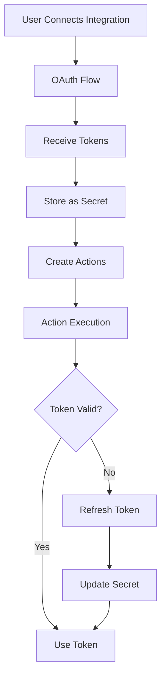

# OAuth Integration & Token Management Guide

## Overview

ProtoBox's OAuth integration system provides secure, automatic token management for third-party services. This guide covers the architecture, token refresh mechanism, and how to add new OAuth integrations.

## Architecture

### Token Lifecycle



### Key Components

#### 1. **OAuth2Integration Base Class**
Base class for all OAuth2 integrations providing:
- OAuth URL generation
- Token exchange
- Token refresh
- Connection testing

#### 2. **Token Storage Strategy**
OAuth tokens are stored as encrypted secrets for security and automatic refresh:
- **Access Token**: Short-lived token for API calls
- **Refresh Token**: Long-lived token for obtaining new access tokens
- **Expiry Time**: Used to determine when refresh is needed
- **Metadata**: Integration-specific data (scopes, user info, etc.)

#### 3. **REST Executor Token Refresh**
The REST executor automatically refreshes expired tokens:
```python
async def _refresh_oauth_token_if_needed(self, secret, decrypted_value, workspace_id, user_id):
    # Check if token is expired (with 5-minute buffer)
    if token_expired:
        # Delegate to integration for refresh
        refreshed_token = await integration.get_fresh_token(current_token)
        # Update secret with new token
        await self.secret_service.update_secret(secret.id, refreshed_token)
```

## Google Services Integration

### Shared Google OAuth Base

All Google services (Calendar, Gmail, Drive) share a common OAuth implementation:

```python
class GoogleOAuth2Integration(OAuth2Integration):
    """Base class for all Google OAuth2 integrations."""
    
    oauth_authorize_url = "https://accounts.google.com/o/oauth2/v2/auth"
    oauth_token_url = "https://oauth2.googleapis.com/token"
    
    async def refresh_token(self, refresh_token: str) -> OAuth2TokenData:
        """Refresh Google access token."""
        # Shared refresh logic for all Google services
```

### Service-Specific Implementations

Each Google service only defines its specific scopes:

```python
class GoogleCalendarIntegration(GoogleOAuth2Integration):
    oauth_scopes = ["https://www.googleapis.com/auth/calendar"]
    
class GmailIntegration(GoogleOAuth2Integration):
    oauth_scopes = ["https://www.googleapis.com/auth/gmail.modify"]
    
class GoogleDriveIntegration(GoogleOAuth2Integration):
    oauth_scopes = ["https://www.googleapis.com/auth/drive.file"]
```

## Implementation Flow

### 1. OAuth Connection

When a user connects an OAuth integration:

```python
async def complete_oauth_connection(workspace_id, integration_type, oauth_data):
    # 1. Create secret with OAuth tokens
    secret_id = await secret_service.create_secret({
        "name": f"{integration_type}_oauth_token",
        "value": oauth_data.model_dump_json(),
        "type": "oauth_token"
    })
    
    # 2. Store secret reference in integration
    await update_integration(
        workspace_id=workspace_id,
        integration_type=integration_type,
        oauth_secret_id=secret_id
    )
    
    # 3. For Google Calendar, fetch calendars and set default
    if integration_type == GOOGLE_CALENDAR:
        calendars = await fetch_user_calendars(oauth_data.access_token)
        primary_calendar = find_primary_calendar(calendars)
        config["default_calendar_id"] = primary_calendar.id
    
    # 4. Create actions with secret references
    await create_integration_actions(workspace_id, integration_type, secret_id)
```

### 2. Action Templates with Secrets

Action templates reference OAuth tokens using secret syntax:

```json
{
  "id": "google_calendar_create_event",
  "default_config": {
    "url": "https://www.googleapis.com/calendar/v3/calendars/{{calendar_id}}/events",
    "method": "POST",
    "headers": {
      "Authorization": "Bearer ${secret:google_calendar_oauth_token.access_token}",
      "Content-Type": "application/json"
    }
  }
}
```

### 3. Automatic Token Refresh

During action execution:

1. REST executor detects `${secret:...}` reference
2. Retrieves secret value
3. Checks if token is expired (5-minute buffer)
4. If expired, calls integration's refresh method
5. Updates secret with new token
6. Uses fresh token for API call

## Adding a New OAuth Integration

### Step 1: Create Integration Class

```python
# In integrations/your_service.py
from .base_classes import OAuth2Integration

class YourServiceIntegration(OAuth2Integration):
    integration_type = IntegrationType.YOUR_SERVICE
    display_name = "Your Service"
    description = "Connect Your Service for ..."
    
    # OAuth configuration
    oauth_scopes = ["scope1", "scope2"]
    oauth_authorize_url = "https://service.com/oauth/authorize"
    oauth_token_url = "https://service.com/oauth/token"
    
    async def refresh_token(self, refresh_token: str) -> OAuth2TokenData:
        """Service-specific token refresh logic."""
        async with httpx.AsyncClient() as client:
            response = await client.post(
                self.oauth_token_url,
                data={
                    "refresh_token": refresh_token,
                    "client_id": settings.your_service_client_id,
                    "client_secret": settings.your_service_client_secret,
                    "grant_type": "refresh_token"
                }
            )
            # Parse and return OAuth2TokenData
```

### Step 2: Add to Integration Registry

```python
# In integrations/__init__.py
from .your_service import YourServiceIntegration

def initialize_integrations():
    registry.register(YourServiceIntegration())
```

### Step 3: Create Action Templates

```json
{
  "id": "your_service_action",
  "integrations": [
    {
      "integration_type": "your_service",
      "required": true
    }
  ],
  "default_config": {
    "headers": {
      "Authorization": "Bearer ${secret:your_service_oauth_token.access_token}"
    }
  }
}
```

### Step 4: Add Environment Variables

```bash
# In .env
YOUR_SERVICE_CLIENT_ID=xxx
YOUR_SERVICE_CLIENT_SECRET=yyy
YOUR_SERVICE_REDIRECT_URI=http://localhost:8090/admin/api/v1/integrations/oauth/callback/your_service
```

## Best Practices

### 1. Token Security
- Always store tokens as encrypted secrets
- Never log token values
- Use HTTPS for all OAuth callbacks
- Implement token rotation on refresh

### 2. Error Handling
- Gracefully handle expired tokens
- Provide clear error messages for auth failures
- Log token refresh attempts for debugging
- Implement exponential backoff for refresh retries

### 3. Scopes Management
- Request minimum required scopes
- Document why each scope is needed
- Allow users to see requested permissions
- Handle scope changes gracefully

### 4. Testing
- Test token expiry scenarios
- Verify refresh token flow
- Test with revoked tokens
- Ensure proper cleanup on disconnection

## Common Issues & Solutions

### Issue: Token Not Refreshing
**Symptom**: 401 errors after token expiry
**Solution**: Ensure refresh_token is stored and integration implements refresh method

### Issue: Secret Not Found
**Symptom**: `${secret:...}` not resolved
**Solution**: Verify secret was created during OAuth connection and name matches

### Issue: Refresh Token Invalid
**Symptom**: Refresh fails with invalid_grant
**Solution**: User needs to reconnect integration (refresh token may be revoked)

### Issue: Scope Insufficient
**Symptom**: 403 errors on specific API calls
**Solution**: Add required scope to integration and have user reconnect

## API Endpoints

### OAuth Management
- `POST /workspaces/{id}/integrations/{type}/connect` - Start OAuth flow
- `GET /integrations/oauth/callback/{type}` - OAuth callback
- `POST /workspaces/{id}/integrations/{type}/refresh` - Manual token refresh
- `DELETE /workspaces/{id}/integrations/{type}` - Disconnect and cleanup

### Google Calendar Specific
- `GET /workspaces/{id}/integrations/google_calendar/calendars` - List user's calendars
- `POST /workspaces/{id}/integrations/google_calendar/set-default-calendar` - Set default calendar

## Security Considerations

1. **Token Storage**: All OAuth tokens stored encrypted using AES-256-GCM
2. **Secret Rotation**: Tokens automatically refreshed before expiry
3. **Audit Logging**: All token operations logged for security audit
4. **Workspace Isolation**: Tokens scoped to specific workspace
5. **Permission Model**: Only workspace admins can manage integrations

## Future Enhancements

1. **Token Provider Interface**: Generic interface for all token providers
2. **Token Caching**: Redis cache for frequently used tokens
3. **Batch Refresh**: Refresh multiple tokens in single operation
4. **Token Analytics**: Track token usage and refresh patterns
5. **Multi-Account Support**: Multiple accounts per integration type